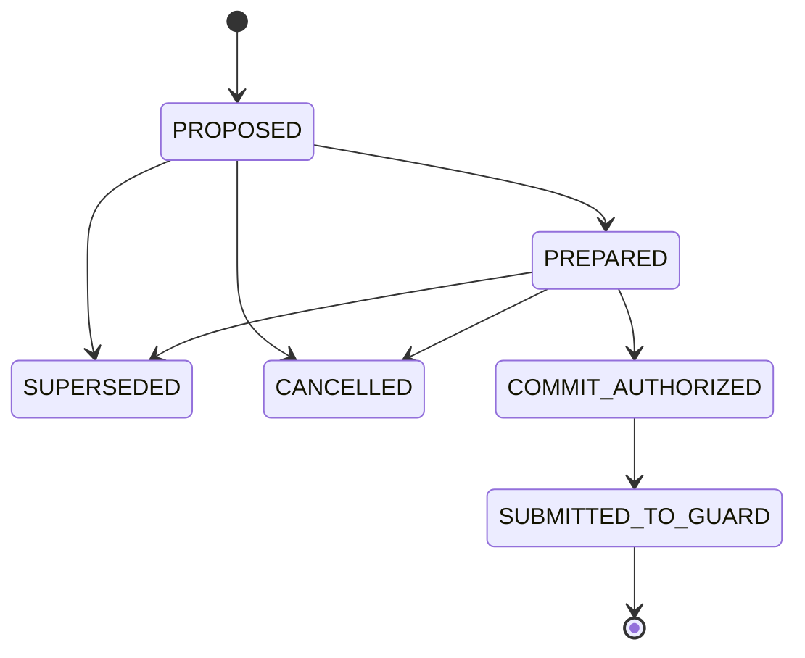

# Agent Execution Safety RFC

- Status: **Proposed**
- Scope owner: `avaargsh/agent-runtime`
- Control-plane integration: `avaargsh/agent-control-panel`
- Date: 2026-11-04
- Related: [Runtime reliability acceptance](../RELIABILITY-ACCEPTANCE.md), [Runtime baseline](BASELINE.md), [Decision integration contract](DECISION-INTEGRATION-CONTRACT.md)

## 1. Problem statement

An Agent may reason, listen, stream a response, and prepare a tool call concurrently. A partial utterance or speculative plan can be useful for latency, but it is not sufficient authority to mutate an external system.

Stopping speech does not stop an already-dispatched action. A corrected intent must invalidate every stale, not-yet-committed proposal. Once a side effect may have crossed an external enforcement boundary, the Runtime must query the owning system and preserve uncertainty rather than pretending that a local cancellation rolled the side effect back.

This RFC defines an **Agent-side execution authorization and submission protocol**. It separates an untrusted Tool Proposal from the durable admission of a request to the authoritative action-enforcement service.

## 2. Non-goals and guarantees

This protocol is **not a distributed transaction, two-phase commit across providers, or a global rollback mechanism**.

ITSM systems, Kubernetes APIs, databases, payment gateways and other providers generally do not participate in one shared atomic transaction. The Runtime cannot make several unrelated external APIs commit or roll back atomically.

The protocol therefore makes the following narrower guarantees:

1. A proposal cannot cross the Runtime commit boundary until its intent revision is current, its capability is allowed, Runtime admission checks pass, and required user confirmation is present.
2. The Runtime persists one stable Guard submission key and immutable request digest before submitting a protected action.
3. A retry with the same key and same request resolves the same Guard operation. A changed request under the same key is a conflict.
4. EngageGuard remains authoritative for action authorization, approval, Permit, operation identity, execution journal, trusted execution and action-level UNKNOWN reconciliation.
5. The Runtime never reports an external effect as successful without authoritative receipt/evidence from the service that owns that effect.
6. Compensation is a new, separately authorized operation. It is not a rollback of a distributed transaction.

The system does not claim exactly-once delivery or exactly-once side effects. It uses durable identity, idempotent submission, authoritative reconciliation and evidence to make retries safe.

## 3. Ownership boundaries (normative)

| Concern | Authority | Responsibility |
|---|---|---|
| AgentBundle / AgentRelease, desired state, Session identity, release lifecycle | Agent Control Plane (ACP) | Declare desired configuration and stable logical identities; bind policy references; consume Runtime status and evidence references |
| Policy and Approval Policy references | ACP / policy authority | Own policy definitions, versions and bindings. Runtime consumes an immutable policy reference/revision for the current admission decision |
| Context Projection policy and source references | ACP | Declare allowed context sources, provenance and projection constraints |
| Conversation / Turn state, intent revision, speculative planning, Tool Proposal lifecycle | Agent Runtime | Own real-time interaction semantics and proposal versioning |
| Prepare / Commit admission, stable Guard submission key, Runtime recovery and Human Handoff coordination | Agent Runtime | Enforce the Runtime commit boundary and preserve execution correlation |
| Durable Workflow history, replay, timers and Activity retry orchestration | Temporal | Own durable workflow semantics; Runtime Workflow code remains deterministic |
| Action authorization, risk evaluation, approval, Permit, Action Operation Journal, operation ID, executor attempt, trusted receipt and action-level UNKNOWN reconciliation | EngageGuard | Authoritative protected-action enforcement and reconciliation |
| Compute Provider / Workload / Allocation / provider-side ComputeOperation and UNKNOWN | Compute Control Plane | Own compute/provider side effects and provider operation reconciliation |
| Actual external resource state | Target provider / owning service | Provide authoritative mutation result and observation |

### 3.1 Hard boundary rules

- ACP owns AgentBundle/Release, Session Identity, policy bindings, approval-policy bindings, Context Projection, Desired State, lifecycle coordination and Evidence references.
- Runtime owns Conversation/Turn State, speculative planning, Tool Proposal, Prepare/Commit, Recovery and Human Handoff real-time semantics.
- Runtime events, approval requests, state changes and Evidence references must flow back to ACP. ACP may project and govern these records; it must not become the owner of the real-time proposal/turn state machine.
- Runtime creates and persists `guard_submission_key` once per admitted proposal. EngageGuard creates `operation_id`; Runtime must never invent a Guard operation ID.
- EngageGuard owns its Action Operation Journal and UNKNOWN state. Runtime may keep a correlation/status projection for its Run, but must not create a competing operation journal or overrule Guard status.
- Runtime never calls a protected executor or provider mutation endpoint directly. Compute CP owns compute provider mutation; other capabilities use their registered trusted enforcement point.
- Temporal owns workflow history and retry orchestration, not the authorization decision for an external side effect.

## 4. Core concepts

### 4.1 Tool Proposal

A Tool Proposal is untrusted output from an Agent Framework / Decision plugin. It describes a requested capability, version, arguments and originating Turn revision.

A proposal is not an authorization grant. Plugin-supplied policy flags, approval status, Permit data, operation IDs or executor credentials are not trusted. Runtime resolves capability metadata and policy references from trusted registries/bindings, then validates the complete proposal against the active capability allow-list and argument schema.

### 4.2 Prepare

Prepare is a side-effect-free Runtime admission stage. It verifies at least:

- proposal identity is bound to the authenticated tenant, Agent, Session, Run and Turn;
- proposal references the current Turn / intent revision;
- capability ID/version is allowed by the active AgentBundle / release;
- arguments validate against the immutable argument-schema digest;
- the trusted capability policy and policy revision are available;
- Runtime admission authorization succeeds;
- any required user confirmation is collected before Commit and is bound to the exact canonical ActionRequest digest, authenticated actor and immutable confirmation Evidence reference.

Prepare may perform read-only lookups and speculative computation. It must not dispatch a protected write.

### 4.3 Commit Boundary

The **Runtime Commit Boundary** is the point where the Runtime durably authorizes and admits one immutable proposal for submission to EngageGuard.

Immediately before crossing it, Runtime must atomically verify the current intent revision (compare-and-swap), intent completion, capability allow-list, Runtime admission decision and required user confirmation. It must persist the stable `guard_submission_key`, canonical ActionRequest digest and commit authorization evidence before any network submission.

This boundary means only that the proposal is authorized for submission to the Guard enforcement path. It does **not** mean that:
- EngageGuard approved the action;
- an approval request has been accepted by a human;
- a Permit was issued or claimed;
- an executor dispatched the side effect;
- the external provider committed the requested change.

For capabilities requiring approval, Runtime submits the proposal through EngageGuard and waits for the authoritative Guard approval/Permit/execution lifecycle. An operation in `WAITING_APPROVAL`, `UNKNOWN`, `RECONCILING` or `MANUAL_REVIEW` is not permission to execute or retry the provider mutation.

### 4.4 Execution and Evidence

EngageGuard / the capability-specific trusted enforcement point performs the protected execution. Runtime records references to the Guard operation, approval decision, trusted receipt and provider observation. Evidence is append-only and linked to tenant, Agent, Release, Session, Run, Turn, Proposal and policy revision.

### 4.5 Recovery and Compensation

Recovery queries the authority that owns the relevant operation. A timeout or lost acknowledgement is an ambiguous observation, not proof of failure.

A compensation is a separate action with its own proposal, authorization, idempotency key, Guard operation, receipt and Evidence. It links to the original action through a causal reference. Whether compensation is possible and safe is determined by the owning provider/capability, not by assuming a general rollback.

## 5. Trusted capability annotations

Capability metadata is resolved from a trusted AgentBundle / capability registry. The plugin may reference a capability; it cannot authoritatively set its risk or execution policy.

Minimum metadata:

| Field | Meaning |
|---|---|
| `capability_id`, `capability_version` | Exact capability contract |
| `argument_schema_digest` | Immutable argument schema used for validation |
| `policy_digest` | Immutable execution-policy snapshot |
| `effect_class` | `READ_ONLY`, `REVERSIBLE_WRITE` or `IRREVERSIBLE_WRITE` |
| `idempotent` | Whether the operation is naturally safe to repeat at the capability boundary; does not permit bypassing Guard reconciliation |
| `requires_confirmation` | Whether the user must explicitly confirm the exact material action |
| `requires_approval` | Whether an authoritative approval is required through Guard |
| `approval_policy_ref` | Immutable reference to the applicable approval policy |
| `compensation_capability_ref` | Registered compensation capability for reversible writes |

Validation rules:

- A reversible write must identify a registered compensation capability.
- A capability requiring approval must identify an immutable approval-policy reference.
- Read-only capabilities must not declare a write compensation.
- Irreversible writes must require at least one of explicit confirmation or authoritative approval; the confirmation must bind the exact ActionRequest digest and authenticated actor.
- Missing, unknown, stale or mismatched annotations fail closed.
- Annotation values provided by the plugin or user never override trusted bundle/registry metadata.

## 6. Runtime Proposal state machine

Runtime Proposal state is separate from the Guard-owned Action Operation state and the Temporal-owned Workflow history.

| State | Meaning |
|---|---|
| `PROPOSED` | Untrusted proposal recorded against a Turn revision; no admission |
| `PREPARED` | Schema, capability, policy and Runtime preflight checks passed; no protected side effect dispatched |
| `SUPERSEDED` | A newer intent revision replaced this proposal before Commit |
| `CANCELLED` | Proposal was abandoned before Commit |
| `COMMIT_AUTHORIZED` | Runtime commit boundary crossed; stable Guard submission key and request digest durably recorded |
| `SUBMITTED_TO_GUARD` | Guard returned its authoritative operation ID, now stored as a correlation reference |

The Guard operation has its own independent state machine. Runtime may expose a read/query projection (for example, `WAITING_APPROVAL`, `UNKNOWN`, `SUCCEEDED`) but does not own or mutate that state.

### 6.1 Correction race

- If a user correction arrives before the Runtime Commit Boundary, Runtime increments the intent revision and marks every stale, uncommitted proposal `SUPERSEDED`. A stale proposal cannot be committed.
- The Commit transition must compare-and-swap the exact current Turn revision. A concurrent correction that wins the race makes the stale Commit fail.
- If the correction arrives after the boundary, Runtime cannot claim that the action was cancelled or rolled back. It requests cancellation through the owning authority when supported, then queries the same Guard operation and preserves `UNKNOWN` until resolved.
- No local state transition may erase evidence that a request may already have crossed the external boundary.

## 7. Idempotency and submission protocol

For each admitted proposal:

1. Runtime computes the canonical ActionRequest and immutable request digest.
2. Runtime binds that digest to the Proposal; the Commit command must present the same digest, and a mismatch is rejected.
3. Runtime allocates a unique `guard_submission_key` and persists it with the digest, Proposal, Turn revision, policy snapshot and commit evidence.
4. Runtime submits the same logical ActionRequest to EngageGuard using that key as the HTTP `Idempotency-Key`.
5. EngageGuard creates and returns its own `operation_id`.
6. The authenticated Guard adapter correlates the returned operation ID with the original tenant, Proposal, submission key and ActionRequest digest before Runtime advances the Proposal. Runtime persists the returned operation reference. A lost ACK is recovered by resubmitting the same key and identical request or querying the same authoritative operation; no new key is generated.
7. The same key with a different request or binding is a conflict.
8. After Guard reports `UNKNOWN` / `RECONCILING` / `MANUAL_REVIEW`, Runtime only queries/waits for authoritative resolution. It does not independently dispatch or retry a provider side effect.

The key is not derived from a Temporal Activity attempt counter, RunAttempt ID or wall-clock timestamp. Temporal retries reuse the same persisted key and immutable request. The capability enforcement point remains responsible for its own downstream idempotency and provider reconciliation.

## 8. Cancellation, human handoff and recovery

- Cancelling speech output, a Turn or a Temporal Workflow does not prove that an already-submitted external operation was cancelled.
- Before Commit, cancellation/supersession is local and prevents submission.
- After Commit, cancellation becomes a request to the owning authority; Runtime must continue to track the same operation until a definitive result or human review.
- Human handoff transfers interaction/decision responsibility while preserving Session, Run, Turn, Proposal, Guard operation and Evidence references. It does not transfer or bypass authorization.
- `UNKNOWN`, `RECONCILING` and `MANUAL_REVIEW` block blind redispatch. Missing receipts and transport timeouts cannot be translated into `FAILED_CONFIRMED`.
- A compensation uses a new authorized operation and its own evidence; it does not mutate the original receipt or erase the original action.

## 9. Evidence and Control Plane event projection

Runtime emits append-only, versioned events and Evidence references for at least:

- `ToolProposalCreated`
- `ToolProposalPrepared`
- `ToolProposalSuperseded`
- `ToolProposalCancelled`
- `ProposalCommitAuthorized`
- `GuardOperationLinked`
- `ApprovalRequested`
- `ApprovalResolved`
- `ExecutionReceiptObserved`
- `RecoveryRequired`
- `CompensationRequested`
- `EvidenceRecorded`

Each event is correlated to trusted tenant / Agent / Release / Session / Run / Turn / Proposal identity, Turn revision, event ID, schema version, occurrence time, policy reference/revision and trace/correlation IDs. Where applicable it includes Guard operation and receipt references plus content digests.

ACP consumes these events to update its governance/lifecycle projection and store Evidence references. ACP must not reconstruct Runtime's real-time state machine from mutable polling data or accept an unverified client-supplied event as authoritative.

Evidence must not contain raw credentials, Permit tokens, private keys or unrestricted tool arguments. Prefer immutable object references, canonical payload digests, schema versions and verified receipt hashes. Corrections append new evidence; they never rewrite history.

## 10. Golden Path: Alice permission correction

The conformance scenario is intentionally independent of Voice / ASR. It tests a generic Agent Runtime action path.

1. Turn revision 11 contains: “Grant Alice administrator permissions.”
2. Runtime records and prepares Proposal `p-admin` against revision 11. It has not crossed Commit.
3. The user corrects the request: “Wait — I meant read-only access.”
4. Runtime advances the intent to revision 12 and marks `p-admin` as `SUPERSEDED`.
5. A new Proposal `p-readonly` is created and prepared against revision 12.
6. Runtime verifies intent completion, current revision, capability allow-list, admission policy and explicit confirmation. It crosses Commit once, persisting one Guard submission key and the canonical request digest.
7. EngageGuard creates one operation and returns `WAITING_APPROVAL`. No external role mutation occurs while approval is pending.
8. The authorized approver approves. EngageGuard / the trusted executor performs the read-only role mutation and returns an authoritative receipt.
9. Runtime verifies and records the receipt reference and final provider observation. The final role is `READ_ONLY`.
10. Replaying the same submission key and digest returns the same Guard operation and receipt. It does not create a second operation or repeat the mutation.

### Required assertions

- The admin Proposal is `SUPERSEDED` and was never submitted to Guard.
- The read-only Proposal crosses Commit only at intent revision 12.
- One Guard operation is created for the read-only proposal; duplicate submission resolves the same operation.
- No mutation occurs before Guard approval / authorization and trusted execution.
- Final observed permission is exactly `READ_ONLY`.
- The Evidence chain includes supersession, commit authorization, Guard operation reference, approval reference, trusted receipt and final observation.
- Replaying the same key/digest is idempotent; a changed digest under the same key is rejected.
- The test does not claim cross-provider atomicity or exactly-once delivery.

## 11. Acceptance and implementation gates

### P0 — Runtime protocol and hermetic conformance

- [ ] Proposal state transitions reject stale revisions and invalid transitions.
- [ ] Runtime Commit requires a complete/current intent, allowed capability, Runtime admission authorization and required user confirmation.
- [ ] A proposal cannot be superseded or locally cancelled after the Commit Boundary.
- [ ] One stable Guard submission key is bound to one immutable request digest.
- [ ] Guard operation ID is accepted only as a returned authority reference.
- [ ] Alice correction Golden Path passes all state, effect, idempotency and Evidence assertions.

### P0 — Durable / external integration (separate gate)

- [ ] Proposal + Guard submission key + request digest + commit Evidence persist atomically in Runtime PostgreSQL.
- [ ] Temporal Activity / Workflow retries reuse persisted proposal and submission identities.
- [ ] Real EngageGuard request/receipt schema and same-key/same-digest behavior are verified.
- [ ] Lost ACK, concurrent correction/commit, Worker restart and UNKNOWN reconciliation pass against real PostgreSQL, Temporal and Guard.
- [ ] Provider-side effect and compensation semantics are verified with the owning provider / Compute CP.

### P1 — Observability and ecosystem

- [ ] Emit versioned proposal/commit/approval/receipt/recovery events to ACP.
- [ ] Expose proposal wait/approval/recovery state without moving Runtime state ownership into ACP.
- [ ] Add Voice Agent-specific turn-taking, barge-in and human-handoff adapters as bounded Runtime inputs, not a separate authority model.

### Reporting rule

Report implementation, automated tests and real-environment acceptance separately. A passing pure-Go test proves the state protocol model only. It does not prove Temporal replay, PostgreSQL crash recovery, EngageGuard integration, provider behavior or production deployment.
